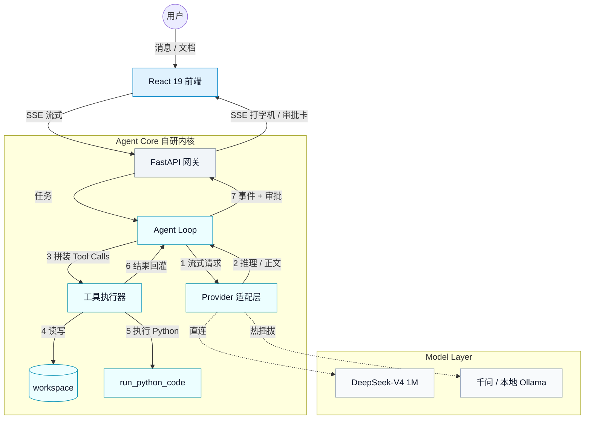
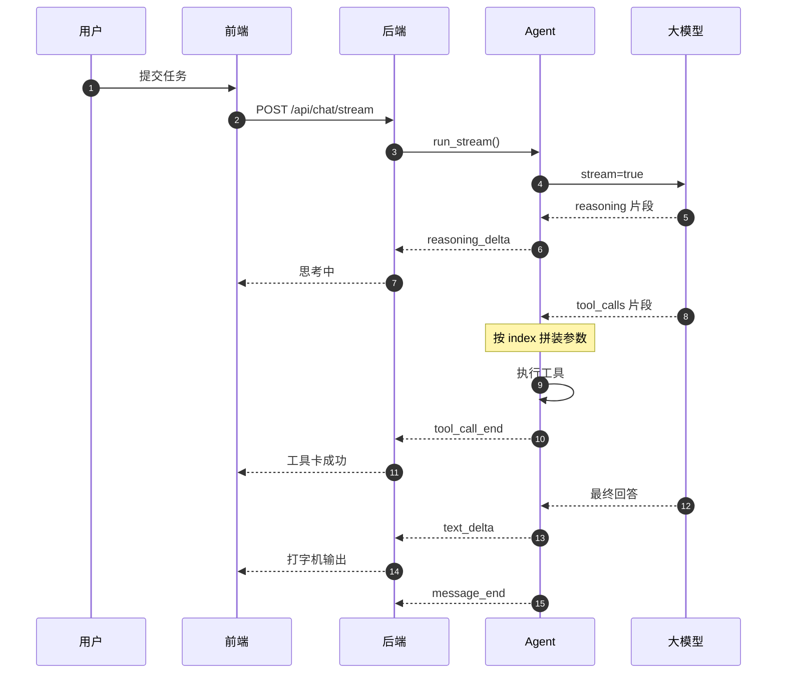
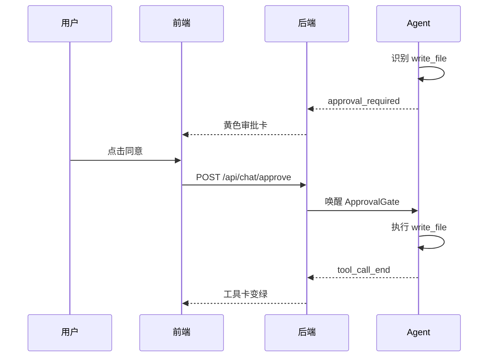
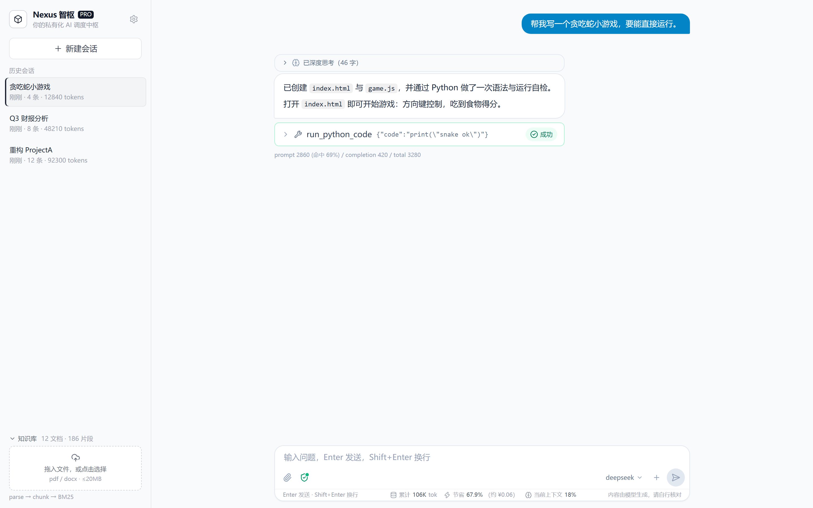
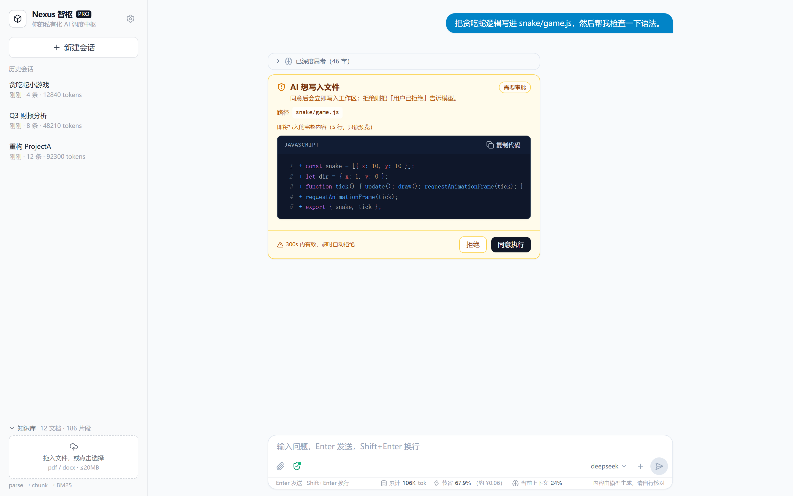

<div align="center">

<br><br>

<h1>Nexus 智枢</h1>
<h3>把大模型变成真正的生产力工具</h3>
<p><b>支持 1M 上下文、本地知识库与可控代码执行的私有化 Agent 中台</b></p>
<br>
<a href="https://github.com/staller12311/Nexus/releases/latest">
  
</a>
<a href="#快速开始">
  
</a>

<br><br>

[](./LICENSE)
[](https://www.python.org/)
[](https://react.dev/)
[](https://tauri.app/)

</div>

[核心特性](#核心特性) · [系统架构](#系统架构) · [界面预览](#界面预览) · [快速开始](#快速开始) · [配置](#配置)

## 为什么做这个？

当前市面上的 AI Agent（如 Coze、Dify）多为云端 SaaS，企业核心数据面临泄露风险；而基于 LangChain 的开源框架往往抽象过重，遇到复杂 Bug 难以调试。

**Nexus 智枢** 是一个**极致轻量、本地优先**的 Agent 中台。我们纯手写了底层 Agent Loop，让你在自己的电脑或服务器上安全地读写文件、执行 Python、检索私有知识库。接本地 Ollama / vLLM 时可完全离线运行；接云模型时仅推理请求出网。

## 它能帮你做什么？

- **本地代码重构**：通过多根挂载（`@libs`），让 AI 安全地读取依赖库，并帮你重构整个项目。
- **私有知识库问答**：上传 PDF/Word 财报，知识库与检索留在本地，AI 精准检索并给出结论（支持 1M 超长上下文）。
- **本地执行与安全边界**：文件工具限定在 workspace；`run_python_code` 是**进程级轻量沙箱，不是 OS 隔离**；`run_shell` 默认只允许白名单裸命令，开启 `allow_unsafe_shell` 后强制人工审批。

## 竞品对比（为什么选我们？）

直接看差异：

| 维度 | 云端 SaaS (如 Coze/Dify) | 纯框架 (如 LangChain) | Nexus 智枢 |
|---|---|---|---|
| 数据隐私 | 数据需上云，有泄露风险 | 需自行搭建，缺乏安全沙箱 | 本地部署；接本地模型可全离线 |
| 执行能力 | 难以直接操作本地文件 | 需大量开发适配器 | 原生支持文件 CRUD、Python 执行 |
| 安全控制 | 依赖平台规则 | 几乎没有防护 | 路径越界拦截、HITL 审批 |
| 底层可控性 | 黑盒调包 | 抽象过重，难以 Debug | 纯手写 Agent Loop，无黑盒 |

## 系统架构



**工具调用**



**人工审批**



## 核心特性

- **自研 Agent Loop**：推理/正文双通道流式解析，`tool_calls` 碎片按 index 拼装，不依赖任何 Agent 框架
- **多模型热插拔**：任意 OpenAI 兼容端点（DeepSeek / 千问 / Moonshot / 智谱 / Ollama / vLLM），一个 YAML 搞定
- **多模态 Vision**：上传图片自动压缩（长边 ≤2048px、JPEG 0.8、≤1MB），后端转 OpenAI Vision 数组；历史图片落盘 `data/uploads`，不把 base64 写进数据库
- **真·流式 Web 体验**：SSE 打字机、思考链折叠、工具卡实时状态、上下文摘要通知，React 19 + Zustand
- **代码搜索与 Git 感知**：`search_code` 在 workspace 内按关键字 + 扩展名检索，`git_status` 只读返回 `git status --short`，不用模型猜文件
- **分级安全边界**：workspace realpath 越界校验、`@mount` 只读挂载、命令/域名白名单、危险工具审批闸门；代码执行不是 OS 隔离，详见下方安全提示
- **会话专属知识库**：文档上传时绑定当前会话，模型只检索本会话文档（旧版全局文档仍兼容）；本会话有文档时直接检索，不再反问用户
- **长上下文记忆**：1M 窗口校准 + 大参数历史压缩 + 80% 自动摘要（不再粗暴砍历史）
- **协议级健壮性**：非法 `function.arguments` 本地拦截、工具异常回灌、上游 400 防御
- **可观测与成本**：Token/缓存命中率/节省估算、结构化日志与密钥脱敏、会话级统计
- **一键启动 / 一键部署**：Windows `start.bat`；Docker Compose 一条命令跑通

## 界面预览

<p align="center"><a href="./assets/ui-chat.png"></a></p>

<details>
<summary><b>审批卡片与代码执行边界（点击展开）</b></summary>

<p align="center"><a href="./assets/ui-approval.png"></a></p>

</details>

## 项目结构

```text
nexus-zhishu/
├── agent/                    # 自研 Agent 内核（零框架依赖）
│   ├── loop.py               # 主循环：流式解析、工具执行、上下文摘要
│   ├── provider.py           # OpenAI 兼容 Provider、usage、重试
│   ├── registry.py           # 工具注册表与 JSON Schema
│   ├── storage.py            # SQLite 会话 / 消息持久化
│   ├── config.py             # pydantic 严格配置校验
│   └── tools/                # 文件、shell、HTTP、Python 执行器
├── backend/                  # FastAPI + SSE 网关
│   ├── api/                  # 路由与请求 / 响应 Schema
│   └── service/              # AgentService、审批、知识库、工作区
│       ├── uploads.py        # 图片落盘 / 校验 / data URL
│       └── vision.py         # OpenAI Vision content 转换
├── frontend/                 # React 19 + Vite + Tailwind
│   └── src/                  # components / store / lib / 图片压缩
├── tests/                    # pytest：主循环、工具安全、审批、Vision
├── docker/                   # Nginx 配置与后端容器入口
├── assets/                   # README 截图（ui-chat / ui-approval）
├── docs/                     # 深度文档
│   ├── whitepaper.md         # 技术白皮书
│   ├── design-decisions.md   # 72 条设计决策
│   ├── api.md                # REST / SSE / 图片上传协议
│   ├── models.md             # 模型接入（含视觉模型）
│   ├── cli.md                # 命令行用法
│   ├── frontend.md           # 前端实现
│   ├── tool-development.md   # 工具扩展
│   └── development.md        # 测试 / 交付 / 历史
├── Dockerfile                # 多阶段：Node → Python → Nginx
├── docker-compose.yml        # backend + web，挂载 data / workspace
├── config.example.yaml       # 配置模板（模型、沙箱、审批、上下文）
├── start.bat                 # Windows 一键启动
├── LICENSE                   # Apache-2.0
└── README.md
```

## 快速开始

**方式 A：Windows 本地一键启动**

```bat
start.bat
```

自动启动后端（8000）与前端（5173）并打开浏览器；关闭窗口或 Ctrl+C 同时停止两者，不留僵尸端口。

**方式 B：Docker 一键部署（推荐给服务器 / 给别人试用）**

```bash
git clone https://github.com/staller12311/Nexus.git && cd Nexus
cp .env.example .env          # 填入 DEEPSEEK_API_KEY（或其它模型密钥）
docker compose up -d          # 首次构建约 3–5 分钟
```

打开 <http://localhost:8080>。`data/`（SQLite 会话、日志）与 `workspace/`（Agent 文件沙箱）
通过 volume 挂载到宿主机；Nginx 负责静态站点与 `/api` 反代，SSE 已关闭缓冲。

> 安全提示：本项目默认面向**完全信任的本地开发环境**（`config.yaml` 中 `require_approval: false`）。
> 如果 workspace 会处理他人代码或不可信输入，请把 `tools.require_approval` 改为 `true`，
> 危险工具（`run_python_code` / `delete_path` / `run_shell`）将重新走人工审批。

> **安全边界（诚实版）**：`run_python_code` 是**进程级轻量沙箱，不是 OS 隔离**——代码以当前后端
> 进程权限运行，能读写该权限触达的文件、访问网络。`tools.allow_unsafe_shell=true` 会让
> `run_shell` 使用 `shell=True` 并绕过命令白名单，且强制每次人工审批；审批只代表人工确认，
> 不能替代 OS 账户、虚拟机或容器隔离。

## 手动安装（开发模式）

适合想改代码 / 跑测试的开发者。

```bash
python -m venv .venv
.venv\Scripts\python.exe -m pip install -r requirements.txt     # Windows
# python -m pip install -r requirements.txt                     # macOS / Linux
```

要求 Python 3.11+。

## Windows 桌面版

桌面版用 Tauri v2 封装前端，并内置一个 PyInstaller onedir 后端；安装后不需要单独启动 Python 或浏览器。

**两种安装包**

构建会在同一目录生成两个安装器：

```text
frontend/src-tauri/target/release/bundle/nsis/
├── Nexus 智枢_1.2.0_x64-personal-setup.exe       # 约 51 MB，自用
└── Nexus 智枢_1.2.0_x64-distribution-setup.exe   # 约 32 MB，分发
```

| | Personal（自用） | Distribution（分发） |
|---|---|---|
| `.env` 真实密钥 | 包含 | 不包含（只有空模板） |
| `config.yaml` | 当前本机配置 | `config.example.yaml` 默认配置 |
| `.venv` | **完整包含** | 不包含 |
| `run_python_code` | 使用随包 venv，可 import 本机已装依赖 | 使用便携 Python，仅标准库 |
| 适用场景 | 自己的电脑，开箱即用 | 给他人/公开分发 |

**构建**

```powershell
# 在仓库根目录执行；默认同时构建 Personal + Distribution
powershell -ExecutionPolicy Bypass -File .\scripts\build-desktop.ps1

# 只构建其中一个
powershell -ExecutionPolicy Bypass -File .\scripts\build-desktop.ps1 -Variant Personal
powershell -ExecutionPolicy Bypass -File .\scripts\build-desktop.ps1 -Variant Distribution
```

构建前置条件：Node.js + npm、Rust + MSVC（`rustup`）、WebView2 Runtime（Windows 11 自带）。
Personal 安装包包含本机 `.env` 和 `.venv`，**只能自己用，不要外发**；如需分享，请构建 Distribution。
个人版 venv 的 `pyvenv.cfg` 指向本机 `D:\python3.11`，因此 Personal 版依赖同一台机器的 Python 安装；分发版不依赖系统 Python。

**运行数据**

首次启动会在 `%APPDATA%\com.stellar.nexus` 下生成 `config.yaml`、`.env`、`prompts/`、`workspace/` 和 SQLite 数据库。
首次启动可能因 Windows Defender 扫描 venv/后端而较慢，启动页最多等待约 45 秒，请勿提前关闭。

启动失败时查看：

```text
%LOCALAPPDATA%\Nexus\logs\desktop.log    # 桌面壳 / 后端启动
%APPDATA%\com.stellar.nexus\data\agent.log # 后端运行日志（若已初始化）
```

安装包未做代码签名，Windows 可能显示 SmartScreen 提示，选择「更多信息 → 仍要运行」即可。

## 配置

```bash
cp config.example.yaml config.yaml      # Windows: copy config.example.yaml config.yaml
cp .env.example .env                    # 填入真实密钥
```

配置加载优先级：命令行 `--config` > 环境变量 `AGENT_CONFIG` > `./config.yaml`。
加载后用 pydantic 校验，缺失必填项会直接报出字段路径，例如：

```
配置校验失败，缺失必填字段：models.deepseek.base_url
  - models.deepseek.base_url: 缺少必填项
```

### 模型接入示例

```yaml
models:
  moonshot:
    base_url: https://api.moonshot.cn/v1
    model: moonshot-v1-8k
    api_key_env: MOONSHOT_API_KEY
  qwen:
    base_url: https://dashscope.aliyuncs.com/compatible-mode/v1
    model: qwen-plus
    api_key_env: DASHSCOPE_API_KEY
  zhipu:
    base_url: https://open.bigmodel.cn/api/paas/v4
    model: glm-4-plus
    api_key_env: ZHIPUAI_API_KEY
  openrouter:
    base_url: https://openrouter.ai/api/v1
    model: openai/gpt-4o-mini
    api_key_env: OPENROUTER_API_KEY
  qwen3-vl-plus:                 # 视觉模型示例
    base_url: https://dashscope.aliyuncs.com/compatible-mode/v1
    model: qwen3-vl-plus
    api_key_env: DASHSCOPE_API_KEY
    supports_vision: true
```

### 新增模型

在 `config.yaml` 的 `models` 下添加任意 OpenAI 兼容端点，或在 Web 界面「模型管理」中直接添加。字段说明、Moonshot 示例与 `config check` 输出见 [docs/models.md](docs/models.md)。

## CLI 用法

除 Web 界面外，也可以直接用命令行运行：

```bash
python -m agent run "你的问题"    # 单次问答
python -m agent chat             # 交互式多轮
python -m agent sessions resume <id>   # 恢复会话
```

完整命令、交互模式、会话恢复、退出码与真实输出见 [docs/cli.md](docs/cli.md)。

## Web 界面（FastAPI + React）

### 一键启动（Windows，推荐日常使用）

```bat
start.bat
```

自动启动后端（8000）与前端（5173）并打开浏览器；关闭窗口或 Ctrl+C 同时停止两者。

- REST 端点与 SSE 事件协议（含审批流）：[docs/api.md](docs/api.md)
- 前端组件、状态管理与历史消息渲染：[docs/frontend.md](docs/frontend.md)

## 开发与测试

```bash
.venv\Scripts\python.exe -m pytest -q
```

当前 **360 passed / 2 skipped**；前端 **40 个测试文件 / 215 passed + 6 skipped**。

完整测试范围、交付清单、已知待办与已清偿技术债见 [docs/development.md](docs/development.md)；新增工具（5 步 + 可运行模板）见 [docs/tool-development.md](docs/tool-development.md)。

## 文档

| 文档 | 内容 |
|---|---|
| [技术白皮书](docs/whitepaper.md) | 项目概述、架构选型、核心突破、安全边界 |
| [设计决策](docs/design-decisions.md) | 72 条关键取舍与原因 |
| [Web API](docs/api.md) | REST 端点、SSE 事件协议、审批流 |
| [模型接入](docs/models.md) | 多 provider 配置与 `config check` |
| [CLI 用法](docs/cli.md) | 命令行、交互模式、会话恢复 |
| [前端实现](docs/frontend.md) | 组件、状态管理、历史消息渲染 |
| [工具开发](docs/tool-development.md) | 新增工具的 5 步模板 |
| [开发与测试](docs/development.md) | 测试、交付清单、待办、技术债 |

## 设计决策

72 条设计决策（配置校验、路径语义、工具边界、流式协议、审批线程模型、上下文摘要、前端交互）见 [docs/design-decisions.md](docs/design-decisions.md)。
