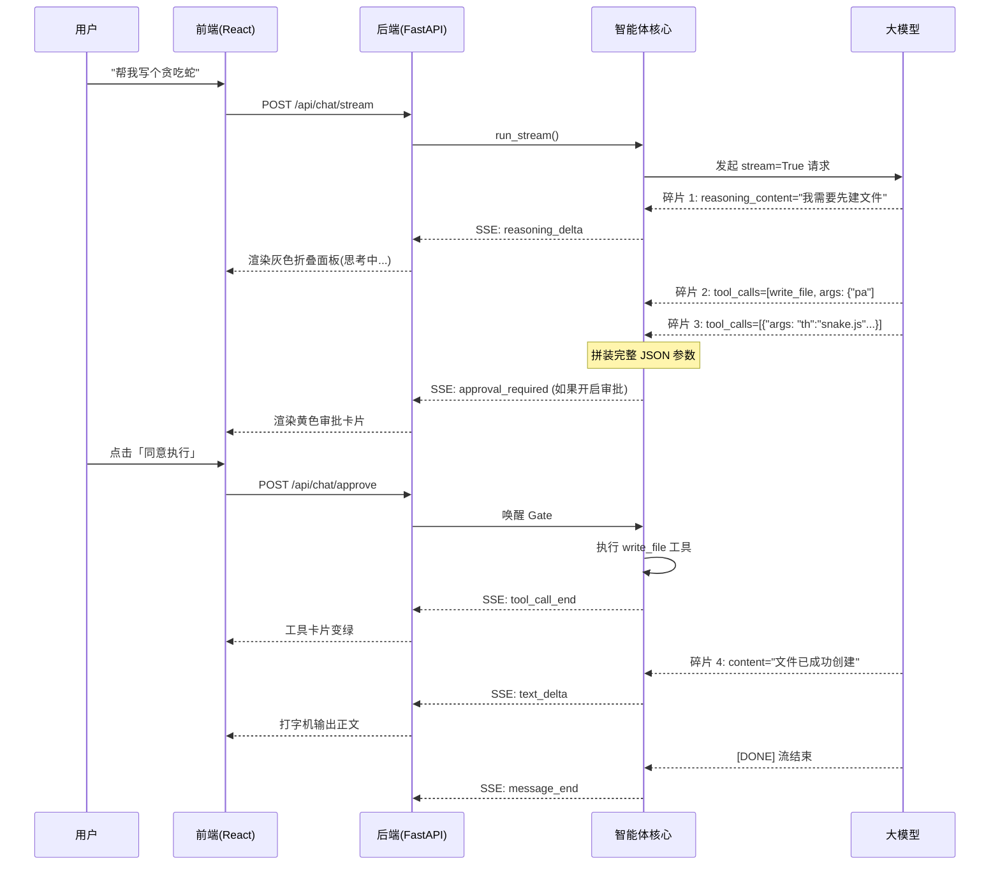

# Nexus 智枢 技术白皮书

> 返回 [README](../README.md)

> **具备企业级安全沙箱的私有化 AI Agent 中台**
> 文档版本：v1.1 · 适用代码：`main`
> 关键词：自研 Agent Loop · 真流式 SSE · 工具沙箱 · Human-in-the-loop · 1M 上下文记忆

---

## 0. 摘要

Nexus 智枢是一套**本地优先、可审计、模型可热插拔**的私有化 AI Agent 中台。它不做“又一个聊天框”，
而是把「多轮推理 → 工具调用 → 文件落盘 → 人工审批 → 结果回灌」完整链路拆成可控、可观测、可回滚的工程系统。

核心技术特征：

| 维度 | 结论 |
|---|---|
| Agent 内核 | 完全自研（无 LangChain / AutoGPT 依赖），同步循环 + 真·流式解析 |
| 协议兼容 | OpenAI / Anthropic 兼容端点，多模型热插拔 |
| 交互 | FastAPI SSE 网关 + React 19 前端，打字机 / 思考链 / 工具卡三态 |
| 安全 | workspace realpath 沙箱、`@mount` 只读挂载、命令/域名白名单、审批闸门 |
| 上下文 | 1M 窗口校准、工具参数历史压缩、80% 自动摘要（替代粗暴裁剪） |
| 质量 | 后端 356 用例（2 skip）、前端 213 用例（6 skip）、`tsc` 全绿 |

**定位**：给个人开发者 / 小团队一套“能写代码、能改文件、能被审计”的本地 AI 工程助手；
而不是把 API Key、代码与执行权限全部交给云端 SaaS。

---

## 1. 项目概述

### 1.1 背景与问题

大模型“能调用工具”之后，真正难的不是 function calling 的 JSON 拼装，而是下面这些工程问题：

1. **流式与工具调用的冲突**：模型一边吐 reasoning/正文，一边吐 `tool_calls` 碎片；
   等流结束时才拿到完整参数，前端却必须实时展示“正在思考 / 正在调工具”。
2. **权限失控**：模型可以写文件、删文件、执行 Python、跑 shell。没有闸门 = 把机器交给概率模型。
3. **上下文焦虑**：长任务动辄几十轮工具调用，历史里全是重复代码；粗暴裁剪会让 Agent“失忆”。
4. **协议脆弱**：模型偶发把 `function.arguments` 的引号转义写坏，上游直接 400，重试到轮数上限。
5. **长会话渲染**：几千条工具结果 + Markdown + 代码高亮，前端很容易被拖垮。

Nexus 智枢逐项给出工程解，并把每个决策固化进 README 的 72 条设计决策与测试用例中。

### 1.2 目标与非目标

**目标**

- 本地可跑：一条命令/一个 bat 启动，不依赖任何云服务（模型 API 除外）。
- 安全可控：工具执行有边界、有审批、有日志、有拒绝路径。
- 可替换：模型、工作区、工具集都通过配置/注册表扩展，不绑死单一厂商。
- 可验证：关键链路（流式、工具、审批、上下文、SSE）都有自动化测试与假端点验证。

**非目标**

- 不是 OS 级沙箱 / 多租户 SaaS：不承诺隔离恶意代码在操作系统层的破坏。
- 不是云原生分布式系统：单机 SQLite + 单进程 FastAPI，追求“一个人能维护”。
- 不做端到端加密、RBAC、审计合规报表：这些属于部署层能力，交由反向代理/OS 账户体系解决。

### 1.3 设计原则

1. **所有历史必须合法**：任何中断（拒绝、超时、客户端断开、异常）都要把 `tool_call` 补成
   `tool` 消息，绝不留下悬空调用。
2. **危险动作默认有闸门**：删除、代码执行、shell 默认走审批；文件写入/建目录在沙箱内可静默。
3. **协议层不信任模型**：`arguments` 必须本地 `json.loads` 校验为 JSON 对象，非法绝不发上游。
4. **可观测优先于“聪明”**：Token、缓存命中、工具耗时、错误原因全部结构化落盘/落库。
5. **失败要可恢复**：摘要失败退回裁剪、审批超时按拒绝、上游 400 本地拦截、渲染异常有 ErrorBoundary。

### 1.4 功能矩阵

| 能力 | 实现 | 备注 |
|---|---|---|
| 多轮对话 / 会话恢复 | SQLite `sessions` / `messages` | 会话级 system prompt、标题、token 统计 |
| 工具调用 | 自研 registry + JSON Schema 校验 | 文件 / 目录 / shell / HTTP / 时间 / 搜索 / 知识库 / Python |
| 真流式 | Provider 流式解析 + SSE 双通道 | reasoning_delta / text_delta / tool_call_* |
| 工具审批 | 线程阻塞 Gate + SSE 审批事件 | 审批/拒绝/超时/断连四种收敛 |
| 工作区沙箱 | realpath + `@mount` 挂载 | 越界拒绝、只读挂载禁写 |
| 上下文管理 | 1M 窗口 + 参数压缩 + 80% 摘要 | 保留最近两轮，摘要写入 system |
| 成本观测 | usage_json + `/api/stats` | 缓存命中率、节省估算 |
| Web 前端 | React 19 + Vite + Tailwind + Zustand | 思考链 / 工具卡 / 代码高亮 / 审批卡 |
| 部署 | `start.bat` / Docker Compose | Nginx + SSE 反代，volume 持久化 |

---

## 2. 架构选型

### 2.1 总体架构

> 图 1：系统整体架构图（宏观降维打击）

```mermaid
graph TD
    User((用户)) -->|发消息 / 传语音| FE[React 19 前端]
    FE -->|SSE 流式接收| API[FastAPI 网关]
    
    subgraph Agent Core (自研智能体核心)
        API -->|推入任务| Loop[Agent Loop 编排器]
        Loop -->|1. 请求并解析流| Provider[Provider 适配层]
        Provider -->|2. 识别 Reasoning 与 Text| Loop
        Loop -->|3. 流式碎片拼接 Tool Calls| Tools[工具执行器]
        Tools -->|4. 读取 workspace & @libs| FS[(本地文件系统)]
        Tools -->|5. 结果回灌| Loop
    end
    
    subgraph Model Layer (多模型底座)
        Provider -.->|直连| DS[DeepSeek-V4 1M 上下文]
        Provider -.->|热插拔| ThirdParty[千问 / Moonshot / 开源模型]
    end
    
    Loop -->|6. 双流事件推送 + 审批请求| API
    API -->|SSE 打字机 & 审批卡| FE
```

> 说明：当前输入通道为文本 + 上传文档；图中的“语音”是预留入口，不在本期实现范围。

### 2.2 技术栈与选型理由

| 层 | 选型 | 为什么不是别的 |
|---|---|---|
| Agent 内核 | 纯 Python 自研（`agent/`） | 需要精确控制流式、历史分组、协议修复；框架会隐藏这些细节 |
| 模型接入 | `openai` SDK + Provider 适配层 | 兼容面最广（DeepSeek、千问、Moonshot、Ollama、vLLM 全部 OpenAI 兼容） |
| Web 网关 | FastAPI + Uvicorn | 原生 async + SSE 简单；与 Agent 线程模型解耦 |
| 流式桥接 | `asyncio.to_thread` + `call_soon_threadsafe` | Agent 循环是同步阻塞的；桥接层负责把事件安全投递进事件循环 |
| 前端 | React 19 + TypeScript + Vite + Tailwind | 流式 UI、状态机、可测试性；无重型 UI 框架 |
| 状态 | Zustand | 轻量、selector 稳定、适合高频 delta 合并 |
| 存储 | SQLite（短连接） | 单机零运维；短连接规避多线程 `check_same_thread` 问题 |
| 部署 | Docker 多阶段 + Nginx | 前端静态化、后端独立、SSE 关闭缓冲 |

### 2.3 请求生命周期

1. 前端 `POST /api/chat/stream` → FastAPI 路由拿到 `session_id/message/model`；
2. 路由创建 `EventBridge`，把同步 `AgentService.chat_stream()` 放进 `asyncio.to_thread`；
3. Agent Loop 组装历史（压缩/摘要/裁剪）→ 调 Provider `stream=True`；
4. Provider 把 reasoning / text / 最终 `tool_calls` 解析成内部事件；
5. Loop 对每个 `tool_call`：校验 JSON → （可选）审批 → 执行工具 → 追加 `tool` 消息；
6. 如果还有 tool_calls，带着结果发起下一轮；否则 `message_end`；
7. 路由把事件编码成 SSE，前端逐帧消费，Store 50ms 合并 delta 后渲染。

### 2.4 多模型 Provider 适配

- 统一 `ChatResult / ToolCall / Usage` 抽象；
- `Usage.from_raw` 同时兼容 DeepSeek 的 `prompt_cache_hit_tokens` 与 OpenAI 的
  `prompt_tokens_details.cached_tokens`；
- 模型上下文窗口从配置/已知模型映射读取，前端状态栏分母与后端摘要触发共用同一数值；
- 自定义模型（Web 界面添加）与内置模型在 `AgentService` 中合并为统一列表。

### 2.5 持久化与状态

- `sessions`：标题、模型、system prompt、累计 token、缓存命中；
- `messages`：seq/role/content/tool_calls/tool_call_id/name/reasoning/usage_json；
- 前端重建历史时按 OpenAI 协议还原 assistant(tool_calls) 与 tool 消息；
- 数据库完整历史永不因“上下文压缩”而被删除——摘要只影响**发给模型的请求**，回放仍是全文。

---

## 3. 核心突破

### 3.1 真流式：双通道 + `tool_calls` 碎片拼装

> 图 2：真流式与工具调用时序图（包含审批与执行）



**难点**：OpenAI 流式协议里 `tool_calls` 是按 `index` 分片到达的，`id/name/arguments` 都可能被拆到多个 chunk。
**实现**：Provider 维护 `tool_slots: dict[index, {id, name, arguments}]`，所有分片拼装完成后
才在 `done` 事件里一次性交付；`arguments` 保持模型原始字符串（不解析再序列化），避免空白/转义变化导致上游行为异常。

### 3.2 线程模型：同步 Agent × 异步网关

- Agent Loop 是同步阻塞代码（便于 CLI 与 Web 复用），Web 层用 `asyncio.to_thread` 跑；
- `EventBridge` 用 `loop.call_soon_threadsafe` 把线程事件投递进 `asyncio.Queue`；
- 路由以 50ms 轮询队列 + `task.done()` 收敛流，既保证低延迟，又避免忙等；
- 客户端断开：SSE 生成器 `finally` 负责取消审批 Gate、补全未回填的 tool 消息，工作线程继续安全收尾。

### 3.3 Human-in-the-loop：线程阻塞审批闸门

**问题**：审批必须“挂起 Agent 循环”，但 HTTP 请求在另一个线程。

**实现**（`backend/service/approvals.py`）：

- `ApprovalGate`：`threading.Event` + 一次性决策，`wait()` 阻塞工作线程，`resolve()` 从 HTTP 线程唤醒；
- `ApprovalRegistry`：进程内未决审批登记表，`approval_id` 一次性；
- 超时（默认 300s）/ 客户端断开 / 显式拒绝 → 统一按“拒绝”处理，工具不执行但 tool 消息照常回填；
- 接口语义：404 = 不存在/过期，409 = 重复决策；
- 前端 `ApprovalCard` 展示 write_file 的只读代码预览（200 行折叠）、删除/移动的不可逆提醒；
- 配置可整体关闭：本地完全信任环境 `require_approval: false`，所有工具静默执行。

### 3.4 上下文工程：1M 窗口 + 参数压缩 + 摘要

传统做法是 `trim_history(max_messages)`，会直接把旧消息砍掉。Nexus 智枢改为三层策略：

1. **历史参数压缩**：`write_file` / `run_python_code` 的 `arguments` 超过 2000 字符时，
   发给模型的历史替换成合法占位 JSON（`{"path": "...", "content": "（N 字符的代码已写入文件，历史中省略）"}`）。
   磁盘文件与前端展示完整保留，上下文不再重复携带代码。
2. **真实窗口校准**：DeepSeek-V4 系列与 Qwen3.8-Flash 官方上下文均为 **1M**
   （Qwen3.8-Flash 最大输入 991,808），内置模型配置与自定义模型已知映射都会返回真实窗口；
   前端状态栏按该值计算占用率（≥80% 琥珀、≥95% 玫红）。
3. **超 80% 自动摘要**：取最旧的 10 条消息（按 assistant+tool 整组，不切断工具组），
   调后台静默模型压成 ≤200 字摘要，写入 system 的「【历史记忆摘要】」块并移除原消息；
   保留最近两轮；摘要失败自动退回按条数裁剪。

关键约束：**数据库完整历史不删**（回放仍是全文），压缩只发生在“下一次请求的上下文”上；
因此不会出现“前端看不到、模型也看不到”的不可逆失忆。

### 3.5 工具安全：沙箱边界

- **路径**：所有相对路径以 workspace realpath 为根，`..`、符号链接、绝对路径越界一律拒绝；
- **挂载**：`@name/` 附加目录默认只读，写入直接报错；临时文件只能写主工作区 `.agent_tmp/`；
- **shell**：`run_shell` 默认禁用，必须显式配置命令白名单，`shell=False` 直接执行；
- **HTTP**：`http_get` 默认禁用，域名白名单 + 重定向校验；
- **代码执行**：`run_python_code` 默认禁用；启用后 `sys.executable -I -B -X utf8`、最小环境、10s 超时、
  输出截断、临时脚本用完即删；**诚实声明：这是进程级轻量沙箱，不是 OS 隔离**。

### 3.6 协议健壮性：非法 JSON 与 400 防御

模型生成 HTML/JS 时偶尔把 `function.arguments` 的引号转义写坏，旧实现会原样回填历史，下一轮上游直接 400，
模型反复重试直到打满轮数。现在在 Loop 构造 assistant 历史前：

- 对每个 `arguments` 做 `json.loads` 且要求解析为 **JSON 对象**；
- 非法 → 替换为合法占位 `{}`，工具不执行，tool 结果回灌
  「参数不是合法 JSON，请重新生成（本次工具未执行）」；
- 模型在同一轮内自我纠正，非法 JSON 永远不会出现在发给上游的请求里；
- 真实 HTTP 假端点测试会抓取每个请求体，逐个 `json.loads` 断言。

### 3.7 前端体验：流式渲染与状态治理

- **50ms delta 合并**：SSE 高频 token 不直接 setState，缓冲后批量提交；超过 2048 字符立即冲刷；
- **流式期间禁止语法高亮**：只渲染纯 `<pre>`，`message_end` 后一次性挂 Prism，避免主线程卡死；
- **工具卡三态**：执行中（旋转）/ 成功 / 失败；审批卡与普通卡分离；
- **滚动跟随**：用户上翻后不再强行拽回底部；程序化滚动标记避免 scroll 反馈环；
- **错误边界**：渲染异常显示可恢复卡片 + 组件栈，并自动上报到本地 `data/client-errors.log`。

### 3.8 可观测性与成本

- 每轮 usage（prompt / completion / total / cache_hit）随 assistant 消息落库；
- `/api/stats?session_id=` 聚合会话级缓存命中率（`cache_hit_tokens / prompt_tokens`），
  前端展示“累计 token / 节省比例 / 上下文占用”；
- 日志统一 UTF-8、轮转、密钥脱敏（格式化后的整行脱敏，异常堆栈同样处理）；
- 前端运行时错误上报到本地诊断日志，不引入第三方监控。

### 3.9 工程验证

- 后端 **356 passed / 2 skipped**：涵盖主循环、Provider、存储、工具安全、配置、CLI、Web API、
  审批、代码执行、上下文压缩/摘要、真实 HTTP 假端点；
- 前端 **40 文件 / 215 passed + 6 skipped**：流式渲染、工具卡、审批卡、滚动/StrictMode 稳定性、
  模型管理、Token 统计、错误边界；
- `tsc --noEmit` 全绿；真实模型 + 假端点双路径验证。

### 3.10 多模态图片理解（Vision，第一批）

- **输入侧**：Composer 前端用 Canvas 把图片压到长边 ≤2048px、JPEG 0.8、≤1MB，再上传；
- **存储侧**：文件落 `data/uploads/`，消息新增 nullable `attachments_json` 只存元数据，base64 永不落库，
  旧会话该列为 NULL，行为不变；
- **协议侧**：backend 在请求期把 `text + attachments` 转成 OpenAI Vision content 数组；agent 只增加
  `run_stream(attachments=...)` 与 `request_transform` 两个 no-op 扩展点；
- **能力侧**：`ModelConfig.supports_vision` 默认 false，内置 `qwen3-vl-plus` 示例；纯文本模型在前端禁用上传、
  后端返回 422，双重拦截；
- **成本侧**：历史最多重放最近 2 轮图片，更早的用 `[图片]` 占位，避免 base64 撑爆 1M 上下文。

---

## 4. 安全边界

### 4.1 威胁模型

| 资产 | 威胁 | 缓解 |
|---|---|---|
| 宿主机文件 | 模型通过路径穿越读写任意文件 | workspace realpath 沙箱、挂载隔离、越界拒绝 |
| 执行权限 | 模型执行恶意 shell / Python | 默认禁用 + 白名单 + 审批闸门 + 超时/输出上限 |
| 密钥 | API Key 泄漏到日志/前端 | 只读环境变量、日志整行脱敏、前端仅返回掩码 |
| 会话数据 | SQLite 并发写坏 / 隐私外泄 | 短连接 + WAL 语义、数据仅本地、Docker volume 自持 |
| 上游稳定性 | 非法 JSON / 超长历史导致 400 | 本地校验、占位压缩、摘要/裁剪、错误回灌 |

### 4.2 边界清单（明确承诺 / 明确不承诺）

**承诺**

- 文件工具不能逃出 workspace（realpath + 挂载名校验）；
- 只读挂载不可写；
- `run_shell` 仅执行 PATH 真实可执行文件且受白名单限制；
- `run_python_code` 临时脚本落在主工作区 `.agent_tmp/`，执行完删除；
- 审批开启时，危险工具必须人工确认；超时/断连按拒绝，历史仍合法。

**不承诺**

- ❌ 不是 OS 级沙箱：`run_python_code` / `run_shell` 以当前后端进程权限运行，能访问该权限触达的文件与网络；
  Windows 下进程完整性级别（Low/Medium）会直接影响可写目录；
- ❌ 不做多租户隔离 / RBAC / 网络出站防火墙；
- ❌ 不拦截模型“合理但危险”的业务指令——最终决策权在操作者；
- ❌ 不做自动密钥轮换、审计合规报表。

### 4.3 部署安全建议

1. 只监听本机/内网：默认绑定 `127.0.0.1`；如需公网，前置反向代理 + 身份认证 + HTTPS；
2. 不可信 workspace：保持 `require_approval: true`，或把危险工具从 `tools.enabled` 移除；
3. 生产 Docker：不要把 Docker Socket 挂进容器；以非 root 运行、只读根文件系统、限制 CPU/内存；
4. 定期备份 `data/`（SQLite）与 `workspace/`；日志按需轮转；
5. 密钥只放 `.env` / 环境变量，永远不要提交到 Git。

---

## 5. 部署与运维

### 5.1 本地一键启动（Windows）

- 双击 `start.bat`：自动设置 `PYTHONPATH`、启动 uvicorn（8000）与 Vite（5173）、打开浏览器；
- 关闭窗口或 Ctrl+C 会清理前后端进程与端口；
- 日志：`data/backend.log`、`data/frontend.log`、`data/agent.log`。

### 5.2 Docker Compose

- 多阶段 Dockerfile：Node 阶段构建 React 静态文件；Python 阶段装运行依赖；Nginx 阶段托管静态与反代；
- `docker compose up -d` 启动 backend + web；访问 `http://localhost:8080`；
- volumes：`./data → /app/data`、`./workspace → /app/workspace`；
- 首次启动自动从 `config.example.yaml` 生成 `config.yaml`；
- Nginx 对 `/api/` 关闭 `proxy_buffering`，否则 SSE 会退化为一次性输出。

### 5.3 备份与恢复

- 备份 `data/`（含 SQLite 主库、知识库切片）与 `workspace/`（Agent 产出文件）；
- 迁移时保持 `config.yaml` 中的相对路径与卷路径一致；
- SQLite 建议停机复制或使用 `.backup`，避免 WAL 不一致。

### 5.4 容量与性能

- 单机 SQLite 适合个人/小团队；会话数、消息数增长后建议按项目拆分 workspace；
- 1M 上下文会话渲染压力大，前端已做 delta 合并与流式不挂高亮，但建议长任务按主题新建会话；
- 工具执行默认 10s 超时（Python）、shell/HTTP 各有白名单与超时，避免单轮无限等待。

---

## 6. 关键指标

| 指标 | 数值 / 说明 |
|---|---|
| 后端测试 | 356 passed / 2 skipped |
| 前端测试 | 40 files / 215 passed + 6 skipped |
| 设计决策 | 72 条（README「设计决策」章节） |
| 支持模型 | 任意 OpenAI 兼容端点；内置 DeepSeek/Qwen/Ollama 示例 |
| 上下文窗口 | DeepSeek-V4 / Qwen3.8-Flash：1M；自定义未知模型：128K 保守估计 |
| 审批超时 | 默认 300s，超时/断连按拒绝 |
| 代码执行 | 默认 10s，输出各截断 8000 字符 |
| 部署形态 | Windows 一键脚本 / Docker Compose |

---

## 7. 封板说明与演进路线

**v1.0 封板**：功能逻辑、性能调优、安全机制冻结；后续只接受缺陷修复与文档/部署改进。
封板时的三条主线：

1. **Agent 内核**：真流式、工具循环、历史合法性与协议健壮性；
2. **安全边界**：workspace 沙箱、审批闸门、执行白名单与诚实的能力边界；
3. **记忆力**：1M 窗口校准 + 参数压缩 + 80% 摘要，解决长任务失忆。

**后续可选方向**（不承诺）：

- 摘要持久化：把摘要 + “已压缩到第几条”写入会话，避免每轮重复生成；
- 前端虚拟列表：进一步降低超长会话的渲染成本；
- 更强的隔离：容器内非 root、只读根文件系统、独立执行账户；
- 可插拔的语音输入（架构图中的预留入口）。

---

## 附录 A：REST 与 SSE 契约

| 方法 | 路径 | 说明 |
|---|---|---|
| POST | `/api/chat/stream` | SSE 对话流（reasoning_delta / text_delta / tool_call_* / message_end / error） |
| POST | `/api/chat/approve` | 审批决策：`{approval_id, approved}`；404 过期、409 重复 |
| GET | `/api/sessions` | 会话列表 |
| GET | `/api/models` | 内置 + 自定义模型（含真实 context_window） |
| GET | `/api/stats?session_id=` | Token / 缓存命中 / 成本估算 |
| POST | `/api/client-error` | 前端运行时错误上报（本地诊断日志） |

审批事件：

```json
{"type":"approval_required","approval_id":"ap_xxx","session_id":"...","tool_call_id":"...","name":"write_file","arguments":"{...}","expires_in":300}
```

---

## 附录 B：设计决策索引

README 的「设计决策」章节共 71 条，覆盖：配置校验、路径语义、工具边界、流式协议、
历史裁剪、重试与错误分类、SQLite 并发、审批线程模型、上下文摘要、部署与前端交互。
本白皮书只抽取架构级结论；实现细节以代码与 `README.md` 为准。